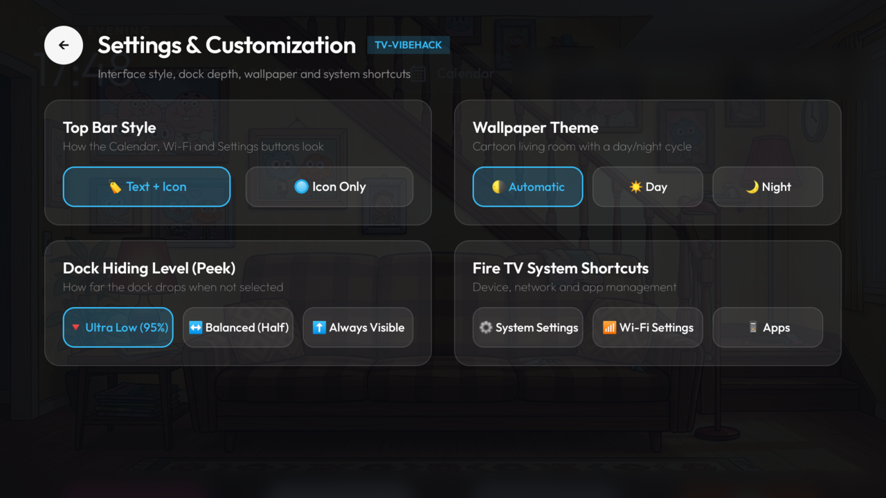

# Amazon Fire TV

Fire OS is Android underneath, so the debloat works the same way, but Amazon locks the home screen.
Tested on a Fire TV Stick 4K (AFTKM), Fire OS 8.1.8.2 (Android 11), from Linux with the stock `adb`.

<p align="center">
  
</p>

## What's different from Android TV

| Upstream step | On Fire TV |
|---|---|
| `cmd package set-home-activity` + disable the stock launcher | Blocked: `com.amazon.tv.launcher` is a protected package. Instead, the launcher's accessibility service brings it back whenever Amazon's home screen comes to the front (`firetv_home_override` in `config.xml`). |
| Catching the Home key | Fire OS handles Home before accessibility services see it, so the override reacts to the window instead. Amazon's home may flash for a moment on a double press. The Home key itself is not intercepted. |
| Opening Fire OS settings | Fire OS opens Settings by briefly showing Amazon's home first. The launcher's System / Wi-Fi / Apps buttons tell the service to let that one pass through. Settings opened from other apps may bounce back to the launcher. |
| Inputs tile | A stick has no HDMI/tuner inputs: add `com.gathin.tvhome.inputs` to `hidden_apps`. |
| `tools/tv.py` | Not needed where the stock `adb` works. The Fire TV scripts use `adb`. |

## Steps

1. On the Fire TV: Settings → My Fire TV → About → press OK on the device name 7 times → back →
   Developer Options → **ADB debugging** on. Note the IP under About → Network.
2. Debloat with the example list (packages are disabled, never uninstalled):

   ```bash
   adb connect <fire-tv-ip>:5555        # accept the prompt on the TV
   grep -vE '^\s*(#|$)' examples/amazon-fire-tv-stick-4k-aftkm/debloat.txt | sed -E 's/\s+#.*$//' |
     while read -r p; do adb -s <fire-tv-ip>:5555 shell pm disable-user --user 0 "$p" </dev/null; done
   ```

3. In `launcher/app/src/main/res/values/config.xml`: set your dock apps, add
   `com.gathin.tvhome.inputs` to `hidden_apps`, leave `live_tv_package` empty, and consider
   `remap_media_keys_to_stremio` = `false` if you don't use Stremio.
4. Build and install:

   ```bash
   TV_HOST=<fire-tv-ip> launcher/build-and-install-firetv.sh
   ```

   It also enables the accessibility service. Reinstalling unbinds that service and writing the same
   setting back doesn't rebind it, so the script clears the setting first and waits for the bind.
5. Turn ADB debugging off again. The launcher and the override keep working without it.

## Undo

```bash
TV_HOST=<fire-tv-ip> tools/restore-firetv.sh examples/amazon-fire-tv-stick-4k-aftkm/debloat.txt
```

Re-enable a single app with `adb shell pm enable <package>`.

## Known limits

- Four Amazon packages are protected and can't be disabled; `com.amazon.vizzini` (Alexa voice UI)
  is re-enabled by Fire OS at boot. Both are marked in the debloat list.
- Updates re-enable packages: a big Fire OS update, and also any Appstore auto-update of a disabled
  Amazon app (seen with Amazon Music). Run the list again afterwards, or turn off automatic updates in
  Settings → Applications → Appstore.
- Amazon's launcher keeps running in the background; it just isn't shown.
